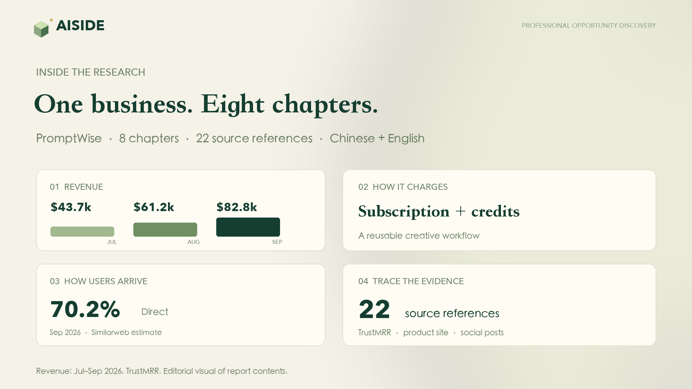
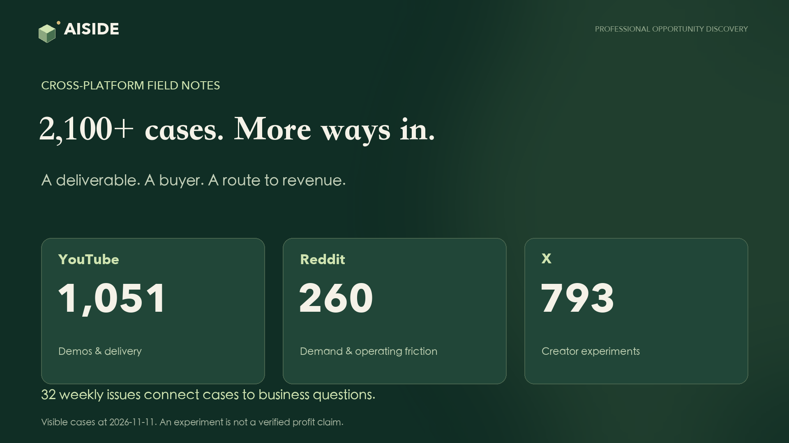

https://github.com/user-attachments/assets/81f2ff8e-ca82-46ed-b3dc-58e0dfc8f36e

# AISIDE — research real businesses, find your next move

**Small ideas. Real possibilities.**

Find a product worth studying. Understand who pays for it, how it reaches customers, and what makes the business work. AISIDE brings business reports, operating data, growth analysis and AI monetization cases into one research library.

[Explore the research](https://aiside.day/en/reports) · [Read PromptWise](https://aiside.day/en/reports/promptwise) · [AI business cases](https://aiside.day/en/cases) · [中文](README.zh-CN.md)

| **1,500+** | **2,100+** | **7,800+** | **32** |
| :--- | :--- | :--- | :--- |
| Bilingual research reports | AI business cases | Product profiles | Weekly research issues |

Catalog snapshot: November 11, 2026. The exact counts are 1,502 reports, 2,104 visible cases and 7,824 products. Chinese and English versions count as one report.

## See what a deep report contains

A useful report connects the numbers to how the business operates. Depending on available evidence, the research covers:

| Research lens | What you can investigate |
| --- | --- |
| **Product & buyer** | What is delivered, who uses it, and which job customers want done. |
| **Revenue & pricing** | Recorded revenue, MRR where disclosed, subscription tiers and usage-based charges. |
| **Customer acquisition** | Traffic sources, search visibility, creator communities and observable growth tactics. |
| **Operating timeline** | How launches, content, pricing and business milestones fit together. |
| **What to adapt** | Specific practices to investigate in your own product or service. |
| **Sources & context** | Original links, metric dates, tables, charts and the distinction between facts and interpretation. |

**Start with [PromptWise](https://aiside.day/en/reports/promptwise): 8 chapters and 22 source references.** Follow its multi-model creative workflow, subscription-and-credit model, monthly revenue history and acquisition channels. The illustration above redraws dated report evidence; it is not a live dashboard or a website screenshot.

Then compare other businesses: [Stan](https://aiside.day/en/reports/stan), [Postiz](https://aiside.day/en/reports/postiz), or the [full report library](https://aiside.day/en/reports). Report depth and available metrics vary by product; missing figures stay unknown.

## Study the experiments around the business

AI business ideas become more useful when you can see **the deliverable, the buyer, the sales route and the costs**.

- **YouTube:** demonstrations, workflows and how people deliver the work.
- **Reddit:** customer problems, practical questions and the friction of running a business.
- **X:** creator experiments, distribution tactics and first-hand operating notes.
- **[Weekly research](https://aiside.day/en/weekly):** selected cases connected through a concrete business question, opportunity analysis and sources.

These include experiments and creator-reported results. Inclusion does not mean a business is profitable or that its revenue has been independently verified.

## Take the research into your workflow

Use the website in [English](https://aiside.day/en) or [Chinese](https://aiside.day/zh), save interesting products, and follow their research. With [Agent / MCP access](https://aiside.day/en/agent), your tools can search products and cases, read report sections and retrieve recorded business metrics through an account-authorized connection.

[Open the library →](https://aiside.day/en/reports) · [Connect your agent →](https://aiside.day/en/agent) · [Membership options →](https://aiside.day/en/pricing)

## Product updates & community

This is AISIDE's official **community and product updates repository**. It hosts release notes and user feedback; the website application's source code is not published here.

- [Releases](https://github.com/A1SIDE/aiside.day/releases) and [website changelog](https://aiside.day/en/changelog): follow what has shipped. Watch → Custom → Releases subscribes to announcements.
- [Report a bug or request a feature](https://github.com/A1SIDE/aiside.day/issues/new/choose): include the affected page and what you expected.
- [Suggest a product or correct research](https://github.com/A1SIDE/aiside.day/issues/new/choose): share the source link and the specific detail to review.

English and Chinese feedback are welcome. Please keep account details, credentials and payment information out of public issues. If the research is useful, a ⭐ helps you find AISIDE again.
