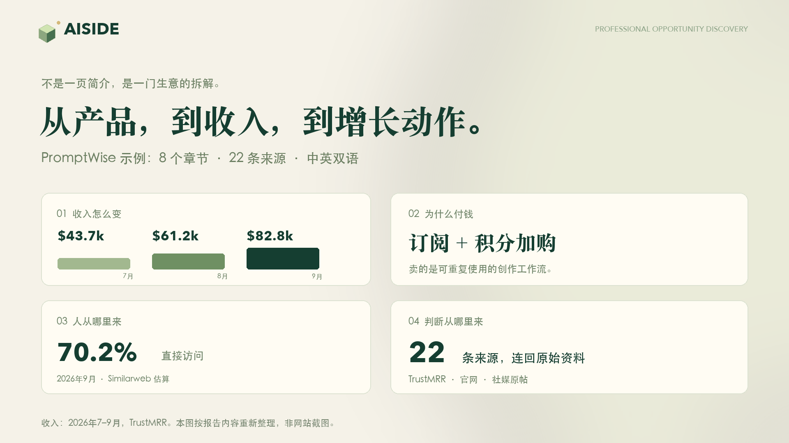
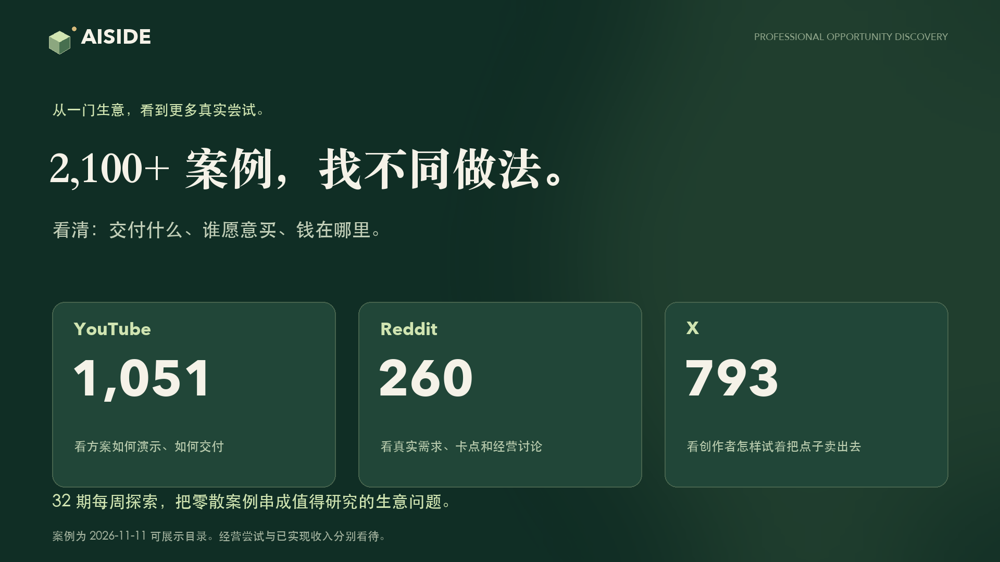

https://github.com/user-attachments/assets/81f2ff8e-ca82-46ed-b3dc-58e0dfc8f36e

# AISIDE · 看懂真实生意，找到下一步机会

**小生意，大可能。**

一款产品为什么有人买？客户从哪里来？收入背后是什么交付和收费方式？AISIDE 把深度报告、经营数据、增长分析和 AI 变现案例放在一起，帮你从“这个产品有意思”，往下看到“这门生意怎么做”。

[浏览深度报告](https://aiside.day/zh/reports) · [先读一篇 PromptWise](https://aiside.day/zh/reports/promptwise) · [AI 变现案例](https://aiside.day/zh/cases) · [English](README.md)

| **1,500+** | **2,100+** | **7,800+** | **32** |
| :--- | :--- | :--- | :--- |
| 双语深度报告 | AI 变现案例 | 产品档案 | 每周探索 |

2026-11-11 目录快照：1,502 篇报告、2,104 个可展示案例、7,824 款产品。中英文为同一篇报告，不重复计数。

## 一篇深度报告，究竟能看到什么？

看见收入，只是开始。更值得研究的是：**它卖了什么、谁愿意付钱、客户怎么来、哪些做法值得自己试。**

| 往下看什么 | 报告里具体研究什么 |
| --- | --- |
| **产品与买家** | 产品交付什么，谁在用，它替客户解决哪件事。 |
| **收入与定价** | 已披露的营收、MRR、订阅层级与用量收费，保留口径和日期。 |
| **获客与增长** | 流量渠道、搜索入口、创作者社区，以及能看到的具体动作。 |
| **经营时间线** | 上线、内容、定价和经营节点如何串起来。 |
| **可以借鉴什么** | 哪个做法值得带回自己的产品或服务中验证。 |
| **原始资料** | 来源链接、数据表、图表与事实依据，方便继续查证。 |

**先读 [PromptWise](https://aiside.day/zh/reports/promptwise)：8 个章节，22 条来源。** 从多模型创作工作流，到“订阅 + 积分加购”，再到逐月收入和流量渠道，把一门具体生意逐层拆开。上图按报告中的历史数据重新整理，并非实时看板或网站截图。

再看看 [Stan](https://aiside.day/zh/reports/stan)、[Postiz](https://aiside.day/zh/reports/postiz)，或进入[完整研究库](https://aiside.day/zh/reports)做对照。不同产品的资料完整度不同，没有披露的数据会保留未知。

## 2,100+ 个案例，看别人具体怎么试

有些案例让你看到一个可以交付的服务，有些让你看到客户真正头疼的问题，还有些让你看到钱花出去了，生意却没跑通。重点始终是：**做什么、卖给谁、怎么交付、钱怎么收、成本怎么算。**

- **YouTube：**看演示、工作流，以及别人如何完成交付。
- **Reddit：**看需求、经营卡点和真实讨论。
- **X：**看创作者的一线尝试、获客动作与经营记录。
- **[每周探索](https://aiside.day/zh/weekly)：**围绕一个具体生意问题，把案例、机会分析和来源串起来。

案例包含经营尝试与作者自述；收录不代表已经盈利，也不代表收入都经过独立核验。

## 把研究带进自己的工作流

用[中文](https://aiside.day/zh)或[英文](https://aiside.day/en)阅读，收藏值得继续研究的产品；通过 [Agent / MCP](https://aiside.day/zh/agent) 连接自己的工具，检索产品与案例、按章节阅读报告、查询已记录的经营指标。接入使用账户授权，权限和额度由服务端校验。

[开始读报告 →](https://aiside.day/zh/reports) · [连接 Agent →](https://aiside.day/zh/agent) · [查看会员方案 →](https://aiside.day/zh/pricing)

## 更新与反馈

这里是 AISIDE 的**官方社区与产品更新仓库**，用于发布更新和收集用户反馈。网站应用源码未在此仓库公开。

- [GitHub Releases](https://github.com/A1SIDE/aiside.day/releases) / [网站更新日志](https://aiside.day/zh/changelog)：查看已上线功能；Watch → Custom → Releases 可订阅发布通知。
- [报告问题或提出功能建议](https://github.com/A1SIDE/aiside.day/issues/new/choose)：附上页面地址、实际情况和预期结果。
- [推荐产品或纠正研究](https://github.com/A1SIDE/aiside.day/issues/new/choose)：给出具体信息和可参考的来源。

欢迎中英文反馈。请勿在公开 Issue 中提交账号隐私、密钥或付款信息。如果研究对你有用，点一颗 ⭐，下次更容易找到 AISIDE。
