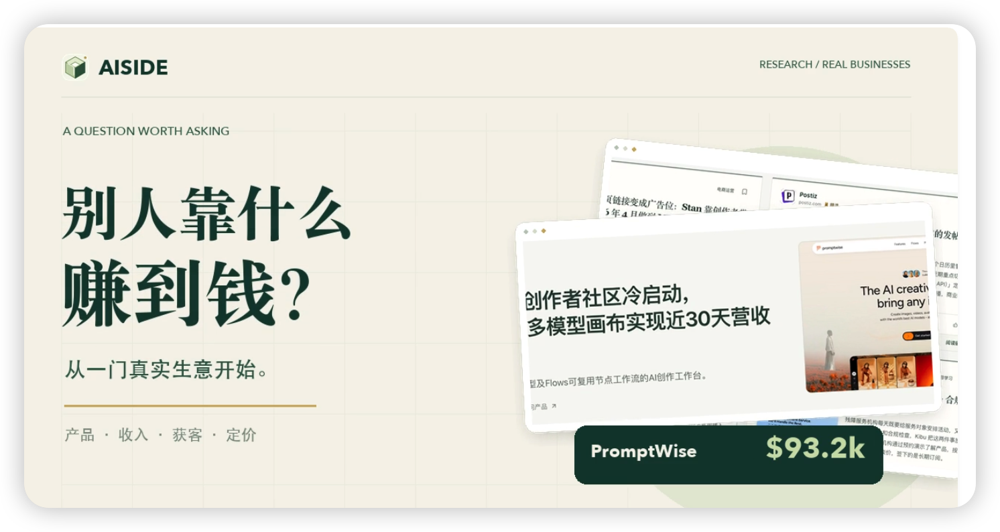

[观看 40 秒宣传片](https://github.com/A1SIDE/aiside.day/releases/download/updates-2026-11-11/aiside-promo.mp4) · [访问 AISIDE](https://aiside.day/zh)

# AISIDE

**小生意，大可能。**

研究真实的线上产品如何赚钱：谁在付费，第一批客户从哪里来，以及有哪些思路值得自己尝试。

[访问 AISIDE](https://aiside.day/zh) · [阅读示例报告](https://aiside.day/zh/reports/promptwise) · [查看产品更新](https://aiside.day/zh/changelog) · [提交反馈](https://github.com/A1SIDE/aiside.day/issues/new/choose)

[English](README.md) · **简体中文**

## 从发现产品，到看懂生意

AISIDE 帮助独立开发者和创业者发现产品、研究商业模式，找到值得进一步验证的方向。

研究报告结合商业分析、来源表、图表和参考资料，帮助你理解产品背后的故事，也方便进一步查看依据。

| 内容 | 你可以了解什么 |
| --- | --- |
| [产品洞察与研究报告](https://aiside.day/zh/reports) | 产品解决什么问题、谁会购买、如何收费，以及如何获取客户。 |
| [AI 变现周刊](https://aiside.day/zh/weekly) | 来自 Reddit、X 和 YouTube 的 AI 商业案例与实践。 |
| [Agent 接入](https://aiside.day/zh/agent) | 如何在你的 Agent 工作流中使用 AISIDE 的研究内容。 |

网站支持[中文](https://aiside.day/zh)和[英文](https://aiside.day/en)。当前会员方案与访问权限见[定价页面](https://aiside.day/zh/pricing)。

## 先读一篇报告

**[PromptWise：整合多种模型的 AI 创作工作台](https://aiside.day/zh/reports/promptwise)**

看看一个整合图像、视频和音频模型的产品，如何服务创作者，如何设计订阅与积分收费，以及如何借助创作者社区获得增长。

再到[研究报告库](https://aiside.day/zh/reports)，比较其他产品获取客户和创造收入的方式。

## 产品更新与用户反馈

这里是 AISIDE 官方的**社区与产品更新仓库**，用于发布更新说明、收集用户反馈。此仓库不提供网站应用的源代码。

- **关注更新：**查看 [GitHub Releases](https://github.com/A1SIDE/aiside.day/releases) 或[网站更新日志](https://aiside.day/zh/changelog)。点击 GitHub 的 **Watch → Custom → Releases**，可以订阅版本更新通知。
- **报告问题：**[新建 Issue](https://github.com/A1SIDE/aiside.day/issues/new/choose)，附上出问题的页面、实际表现和预期结果。
- **提出功能建议：**描述你想完成的任务，以及这项改进能带来什么帮助。
- **纠正报告或推荐产品：**附上相关页面或产品链接；如有参考来源，也欢迎一并提供。

欢迎使用**中文或英文**反馈。提交前请先搜索[已有 Issues](https://github.com/A1SIDE/aiside.day/issues)，并避免在公开 Issue 中填写账号隐私、密钥或支付信息。

如果 AISIDE 对你的研究有帮助，欢迎点个 ⭐，方便以后找到，也帮助更多人发现这个项目。

---

[访问 AISIDE](https://aiside.day/zh) · [查看更新日志](https://aiside.day/zh/changelog) · [提交反馈](https://github.com/A1SIDE/aiside.day/issues/new/choose)
